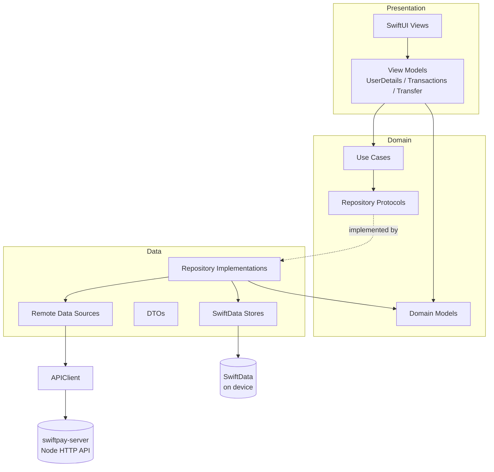
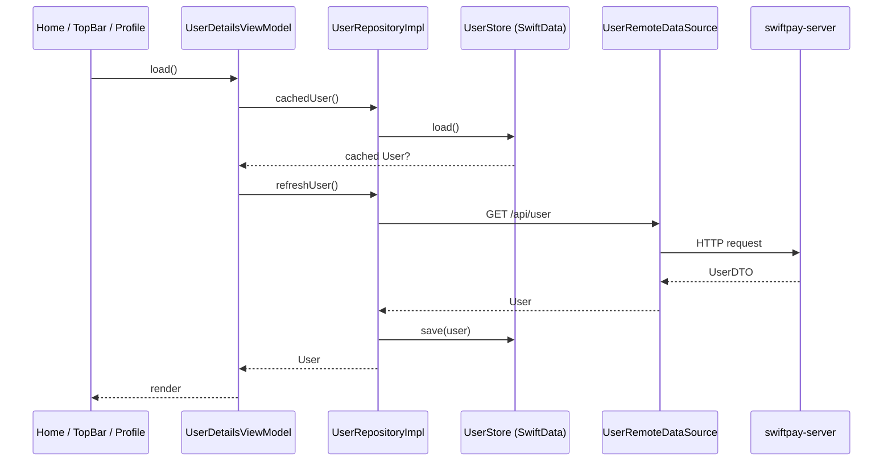
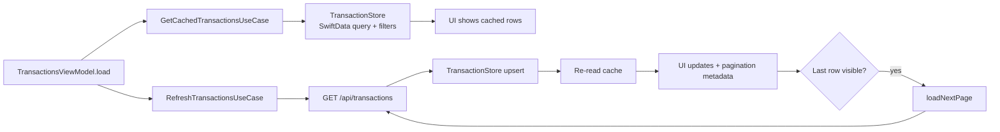
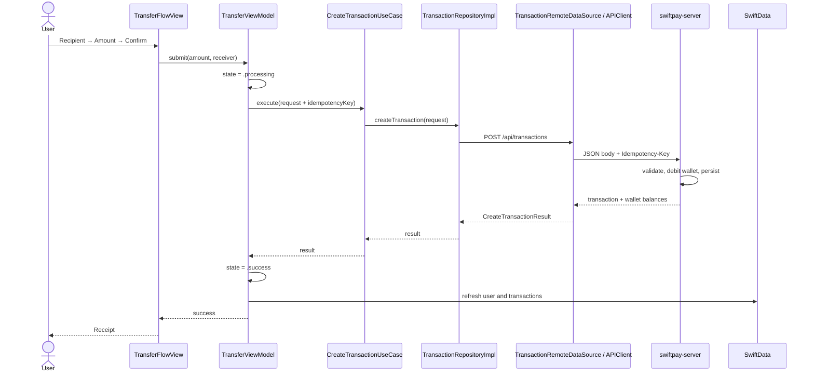

# SwiftPay

SwiftPay is a native iOS wallet app built with SwiftUI and SwiftData, backed by a small file-based Node.js API. It supports viewing a wallet balance, browsing and filtering transactions, viewing and sharing payment receipts, and sending money through a three-step transfer flow.

The app is a local demo project: there is no authentication, no cloud backend, and no third-party iOS dependency.

---

## Table of Contents

- [Features](#features)
- [Screens](#screens)
- [Architecture](#architecture)
- [Data Flow](#data-flow)
- [Project Structure](#project-structure)
- [Getting Started](#getting-started)
- [Backend API](#backend-api)
- [Data and Persistence](#data-and-persistence)
- [Configuration](#configuration)
- [Development Notes](#development-notes)
- [Known Limitations](#known-limitations)

---

## Features

- Wallet balance with a temporary hide/show toggle on Home; launch visibility is configured in Profile and persisted locally
- Home screen with greeting, balance, five most recent transactions, and pull-to-refresh
- Full transaction history with:
  - Text search
  - All / Credit / Debit filters
  - Date-range filtering
  - Cursor-based pagination and pull-to-refresh
- Pull-to-refresh on Home and Transactions reloads both transactions and the profile
- Transaction detail/receipt screen with copyable transaction ID and native iOS sharing
- Three-step transfer flow: Recipient → Amount → Review
- Server-side balance validation and idempotent payment submission
- "Send again" shortcut that opens a fresh transfer form
- Editable profile (name, mobile number, UPI ID, photo) with a success toast and automatic dismissal
- Offline indicator under the SwiftPay title that appears when the device loses connectivity
- Local caching so the app can show the last known data when the server is unreachable
- Success/coin sound effects and haptic feedback

---

## Screens

### App shell

| Screen | Entry point | What it does |
| --- | --- | --- |
| Splash | App launch | Shows the SwiftPay launch logo, then immediately swaps to the main tab view. |
| Main tabs | After splash | Hosts the Home, Transfer, and Transactions tabs. The profile screen is presented as a full-screen cover from the top bar avatar. |
| Profile | Avatar in the top bar | Edits name, mobile number, UPI ID, and profile photo. Saves with `PATCH /api/user`, shows a success toast, then closes. Also toggles "Show balance on launch". |

### Home

`Presentation/Home/HomeView.swift`

- Displays a time-aware greeting and the user's UPI ID.
- Shows the wallet balance card; the eye button hides/shows the balance temporarily for the current session. The persisted launch preference lives in Profile (`profile.showsBalanceOnLaunch`), and Home re-reads it when the app launches or the preference changes.
- **Send Money** switches to the Transfer tab.
- **Transactions** switches to the Transactions tab.
- Lists the five most recent transactions; tapping one opens the transaction detail screen.
- Pull-to-refresh reloads the transaction list and the profile.

### Transactions

`Presentation/Transactions/Views/TransactionsView.swift`

- Search field filters by transaction ID, sender/receiver name, mobile number, or UPI ID.
- Filter chips: All, Credit, Debit.
- Calendar button opens a date-range sheet; the applied range covers full days.
- Infinite scrolling loads the next page as the last row becomes visible (page size 5).
- Pull-to-refresh fetches the latest page from the server and refreshes the profile.
- Tapping a row opens the transaction detail screen.

### Transaction detail / receipt

`Presentation/Transactions/Views/TransactionDetailView.swift`

- Opened from Home, Transactions, and the last step of the transfer flow.
- Shows payment status (Success, Processing, or Cancelled), amount, timestamp, counterparty, debiting/crediting wallet, fee, and transaction ID.
- Transaction ID can be copied to the clipboard.
- **Send again** resets the transfer flow and opens the first transfer screen with an empty form. This works from all entry points.
- **Share receipt** opens the native iOS share sheet with a formatted text receipt containing the status, counterparty, amount, date, wallet, transaction ID, and fee.

### Transfer flow

`Presentation/Transfer/TransferFlowView.swift`

| Step | Screen | What it does |
| --- | --- | --- |
| 1 | Recipient | Collects recipient name, 10-digit mobile number, and UPI ID. Validates before continuing. |
| 2 | Amount | Numeric amount entry with two-decimal normalization and wallet-balance validation. |
| 3 | Review | Shows recipient, transfer amount, fee, total, and the wallet being debited. Confirming starts payment. |
| — | Processing | Shows a spinner while `POST /api/transactions` is in flight. Back navigation is blocked. |
| — | Receipt | On success, shows the transaction detail screen. "Send again" resets the flow in place. |

Validation errors are surfaced inline on each step. If the network times out or the server returns a 5xx, the app reports that the payment outcome is unknown and refreshes profile/transactions so the user can check before retrying.

### Other UI pieces

- `PaymentStatusCard` and `PaymentSummaryCard` render the receipt.
- `TransferStepIndicator` shows the 1-2-3 progress indicator.
- `AppTopBar` provides the SwiftPay title, profile avatar, notifications bell (bell is currently a placeholder), and a red "No Internet!" line under the title when offline.
- `Theme.swift` contains the design system: colors, spacing, radii, and typography.

---

## Architecture

The project uses a clean-ish layered architecture with protocol boundaries between presentation, domain, and data.

### Layers

| Layer | Location | Responsibility |
| --- | --- | --- |
| App | `Swiftpay/App`, `Swiftpay/SwiftpayApp.swift` | App entry point, dependency container, environment injection. |
| Presentation | `Swiftpay/Presentation` | SwiftUI views, view models, and presentation models. |
| Domain | `Swiftpay/Domain` | Domain models, repository protocols, and use cases. No UI or networking code. |
| Data | `Swiftpay/Data` | Repository implementations, remote API client/data sources, DTOs, and SwiftData stores. |
| Core | `Swiftpay/Core` | Design system, reusable components, and small utilities. |

### High-level diagram



### Dependency injection

`App/DependencyContainer.swift` builds the object graph once:

1. Creates the SwiftData `ModelContainer` (`UserStore.makeContainer()`).
2. Creates `UserRepositoryImpl` with `UserRemoteDataSource` + `UserStore`.
3. Creates `UserDetailsViewModel`.
4. Creates `TransactionRepositoryImpl` with `TransactionRemoteDataSource` + `TransactionStore`.
5. Creates `TransactionsViewModel` and `CreateTransactionUseCase`.

`SwiftpayApp` injects these into the SwiftUI environment:

- `\.userDetails` — custom `EnvironmentValues` key
- `\.createTransactionUseCase` — custom `EnvironmentValues` key
- `transactions` — `EnvironmentObject`
- `networkMonitor` — `EnvironmentObject` backed by `NWPathMonitor`

`MainTabView` also injects `\.openProfile` and `\.startNewTransfer` actions so any screen can open the profile or reset the transfer flow without owning that navigation state. `AppTopBar` reads `networkMonitor` to display the offline note under the SwiftPay title.

---

## Data Flow

### User load



If the refresh fails, the view model keeps the cached user and flags that the cached profile is being shown.

### Transactions load and pagination



The cache is the single source of truth for the list; the network response is upserted into SwiftData and then re-read. Query generation counters prevent stale responses from overwriting newer search/filter results.

### Transfer / payment



Important payment behavior:

- A UUID idempotency key is created per attempt and sent in the `Idempotency-Key` header. The server stores and replays responses for duplicate keys, which protects against double charges when a response is lost.
- After both success and failure, the app refreshes the user profile and transaction list to reconcile with the server.
- Network failures, timeouts, and 5xx responses are treated as an unknown outcome; 4xx responses are treated as normal failures.

### Profile update

`ProfileView` → `UserDetailsViewModel.save(...)` → `UpdateUserUseCase` → `UserRepositoryImpl.updateUser` → `PATCH /api/user` → `UserStore.save` → UI.

---

## Project Structure

```text
Swiftpay/
├── Swiftpay.xcodeproj
├── Swiftpay/
│   ├── SwiftpayApp.swift          # App entry point and environment injection
│   ├── Info.plist                 # Display name (SwiftPay) and local networking
│   ├── ContentView.swift          # Design-system swatch preview (not used by the app)
│   ├── App/
│   │   └── DependencyContainer.swift
│   ├── Core/
│   │   ├── Components/            # AppButton, AppTextField, AppTopBar, TransactionList
│   │   ├── DesignSystem/          # Theme (colors, spacing, typography)
│   │   ├── Extensions/            # View+Keyboard
│   │   └── Utilities/             # PaymentFeedback, DayRange, SwipeBack, NetworkMonitor
│   ├── Data/
│   │   ├── DTOs/
│   │   ├── LocalStorage/
│   │   │   ├── BalanceVisibilityStore.swift
│   │   │   └── SwiftData/         # StoredUser, StoredTransaction, stores
│   │   ├── Remote/                # APIClient, APIError, APIs, data sources
│   │   └── Repositories/
│   ├── Domain/
│   │   ├── Models/
│   │   ├── Repositories/          # Protocols
│   │   └── UseCases/
│   ├── Presentation/
│   │   ├── Home/
│   │   ├── Profile/
│   │   ├── Splash/
│   │   ├── Transactions/
│   │   ├── Transfer/
│   │   └── MainTabView.swift
│   ├── Resources/                 # PaymentSuccess.m4a, CoinDrop.m4a
│   └── Assets.xcassets
└── swiftpay-server/
    ├── server.js                  # File-backed Node HTTP API
    ├── package.json
    └── data/
        ├── user.json
        ├── transactions.json
        └── photos/
```

---

## Getting Started

### Prerequisites

- macOS with **Xcode 26 or newer** (the app targets iOS 26.0)
- **Node.js 18+** for the local API server
- An iOS 26 simulator or device

No CocoaPods, Swift Package Manager, or npm dependencies are required.

### 1. Start the backend

From the repository root:

```bash
cd swiftpay-server
npm start
```

`npm start` runs `node server.js`. The API listens on **http://127.0.0.1:4000** by default and writes its data to `swiftpay-server/data/`.

Verify it is running:

```bash
curl http://127.0.0.1:4000/
```

You should receive a JSON index of the available endpoints.

To use a different port:

```bash
PORT=4001 npm start
```

If you change the port, also update the app's base URL (see [Configuration](#configuration)).

### 2. Run the iOS app

1. Open `Swiftpay.xcodeproj` in Xcode.
2. Select the **Swiftpay** scheme and an iOS 26 simulator.
3. Press **⌘R**.

The app launches on the splash screen and moves to the Home tab. Keep the server running so the profile and transactions can refresh; if it is unreachable, the app falls back to whatever is cached on the device.

### 3. First-run and demo data

The server creates `data/user.json` and `data/transactions.json` if they are missing. A brand-new seeded user has an empty name and a wallet balance of `0`, so transfers will fail until the wallet is funded.

To fund the demo wallet:

1. Stop the server.
2. Edit `swiftpay-server/data/user.json` and set `walletBalance` to a positive number.
3. Start the server again.

You can set the profile name, mobile number, UPI ID, and photo from the in-app Profile screen. The server has no top-up endpoint, so wallet balance is edited directly in the JSON file.

### Resetting demo data

1. Stop the server.
2. Delete `swiftpay-server/data/user.json` and `swiftpay-server/data/transactions.json`.
3. Restart the server. Both files are re-seeded automatically.
4. Optionally uninstall the app from the simulator to clear its SwiftData cache.

---

## Backend API

Base URL: `http://127.0.0.1:4000`

| Method | Endpoint | Purpose |
| --- | --- | --- |
| `GET` | `/` | Returns the API index. |
| `GET` | `/api/user` | Fetch the wallet user (including base64 photo, if any). |
| `PATCH` / `PUT` | `/api/user` | Update name, mobile number, UPI ID, and optional photo. |
| `GET` | `/api/transactions` | List transactions. Supports `limit`, `type`, `q`, `from`, `to`, `cursor`, and `page`. |
| `GET` | `/api/transactions/quote` | Quote a transfer. Requires `type` (`credit`/`debit`) and `amount`; `currency` defaults to `INR`. |
| `GET` | `/api/transactions/:transactionId` | Fetch one transaction by ID (for example `TXN0001015`). |
| `POST` | `/api/transactions` | Create a transfer. Requires a JSON body and an `Idempotency-Key` header (or body field). |

### Create transaction body

```json
{
  "type": "debit",
  "amount": 480,
  "currency": "INR",
  "senderDetails": {
    "name": "Aarav Shah",
    "mobileNumber": "9876543210",
    "upiId": "aarav.shah@swiftpay"
  },
  "receiverDetails": {
    "name": "Swiggy",
    "mobileNumber": "9988776655",
    "upiId": "swiggy.orders@swiftpay"
  }
}
```

Send `Idempotency-Key: <uuid>` as a request header. The server stores the key and replays the original response for retries.

### Transaction fields

| Field | Notes |
| --- | --- |
| `id` | Format `TXN0000001`. |
| `type` | `credit` or `debit`. |
| `amount` | Transfer amount. |
| `currency` | `INR`. |
| `status` | `pending`, `success`, or `cancelled`. |
| `timestamp` | ISO 8601 timestamp. |
| `fee` | Transfer fee; currently fixed at `0`. |
| `totalAmount` | `amount + fee` for debits. |
| `senderDetails` / `receiverDetails` | Party name, mobile number, and UPI ID. |
| `error` | Optional `{ code, message }` for failed transactions. |

### Server error behavior

- Invalid input returns `400` with `INVALID_REQUEST`.
- Insufficient balance returns `422` with `INSUFFICIENT_BALANCE`.
- Unreadable data files or storage failures return `503` with `NETWORK_ERROR`.
- The server logs each request/response (base64 photo data is shortened in logs).

---

## Data and Persistence

### On device

- **SwiftData** stores `StoredUser` and `StoredTransaction`, created by `UserStore.makeContainer()`.
- `UserStore` keeps a single user record and replaces stale records when the user ID changes.
- `TransactionStore` upserts transactions by ID and filters/sorts them locally for cached reads.
- **UserDefaults** stores `profile.showsBalanceOnLaunch`, which is edited in Profile. The Home eye toggle is temporary and never writes this value.

### On the server

- `swiftpay-server/data/user.json` — single wallet user.
- `swiftpay-server/data/transactions.json` — transaction list, next ID counter, and idempotency response cache.
- `swiftpay-server/data/photos/` — uploaded profile photo (`profile.jpg` or `profile.png`).

Writes are atomic: the server writes to a temporary file and renames it into place.

---

## Configuration

| Setting | Location | Default |
| --- | --- | --- |
| API base URL | `Swiftpay/Data/Remote/APIClient.swift` (`APIClient.live`) | `http://127.0.0.1:4000` |
| Server port | `swiftpay-server/server.js` / `PORT` env var | `4000` |
| Home screen app name | `Swiftpay/Info.plist` (`CFBundleDisplayName`) | `SwiftPay` |
| Deployment target | Xcode project | iOS 26.0 |
| Swift version | Xcode project | Swift 5 language mode |

### Running on a physical device

`127.0.0.1` only works from the simulator. On a device, change the base URL in `APIClient.live` to your Mac's LAN address, for example:

```swift
static func live(
    baseURL: URL = URL(string: "http://192.168.1.10:4000")!
) -> APIClient {
```

Keep the Mac and iPhone on the same network. `Info.plist` already enables `NSAllowsLocalNetworking`.

---

## Development Notes

- **No third-party dependencies.** Everything is built with Apple frameworks and Node built-ins.
- **Concurrency:** view models are `@MainActor`; networking uses `async`/`await`; SwiftData uses the main model context.
- **Error mapping:** `APIClient` maps `URLError` and HTTP failures to `APIError` (`unreachable`, `timedOut`, `undecodable`, `server(status:code:message:)`).
- **Idempotency:** a new key is generated per payment attempt; keys are cleared after a confirmed success or a definitive 4xx failure.
- **Refresh after payment:** both the profile and transaction list are refreshed after every payment attempt, including failures.
- **Cached-first UX:** user and transaction screens render cached data first, then refresh from the server.
- **Connectivity:** `NetworkMonitor` uses `NWPathMonitor`, restarts when the app becomes active, and drives the red "No Internet!" note under the SwiftPay title.
- **Receipt sharing:** `ShareLink` opens the system share sheet with a formatted text receipt.
- **Accessibility:** transaction rows, balance visibility, buttons, and the step indicator include accessibility labels.
- **Sounds:** `PaymentSuccess.m4a` and `CoinDrop.m4a` play through `AVAudioPlayer` with the ambient audio category.
- **Swipe-back:** transfer steps and the receipt disable the interactive pop gesture where appropriate.

### Build from the command line

```bash
xcodebuild \
  -project Swiftpay.xcodeproj \
  -scheme Swiftpay \
  -destination 'generic/platform=iOS Simulator' \
  build CODE_SIGNING_ALLOWED=NO
```

There are currently no unit or UI test targets.

---

## Known Limitations

- No authentication or multi-user support.
- No top-up flow; wallet balance must be edited in `user.json` for a fresh seed.
- Transfer fee is fixed at `0` on the server.
- The notifications bell is a placeholder.
- The Home **Send Money** button only switches to the Transfer tab; **Send again** explicitly resets the form.
- The backend is local, file-backed, and served over plain HTTP.
- `swiftpay-server/data/` contains sample/demo data and is committed to the repository; do not store real personal data there.
